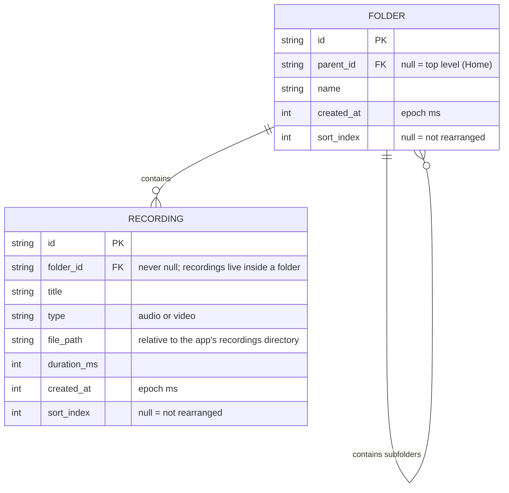

# Data model

Two entities, from `project_specs/product_spec.md`. Files are stored in the app's private storage, and the database keeps their paths.

## Rules

- **One mixed list per folder.** The items of a folder are its child folders (`FOLDER.parent_id = id`) plus its recordings (`RECORDING.folder_id = id`). The app merges and orders them in code.
- **Order.** Items are ordered by `sort_index` ascending, items with `sort_index = null` last, and ties or nulls by `created_at` ascending. With no rearranging every `sort_index` is null, so the order is oldest first. A new item has a null `sort_index`, so it lands at the end.
- **Saving a rearrangement** writes `sort_index` 0..n-1 for every item currently in that folder (folders and recordings). Cancel writes nothing. `sort_index` is shared across both tables for one parent, so it only compares within a single folder.
- **Top-level folders** (`parent_id = null`) are not rearrangeable, so they are always in created order.
- **Playlist** = the recordings of the folder in the order above. Subfolders are skipped. The playlist and the mini player are in memory only and are not stored.
- **Delete folder** cascades: `FOLDER.parent_id` and `RECORDING.folder_id` use `ON DELETE CASCADE`. The repository also deletes the recording files from disk.
- **Move recording** changes only `RECORDING.folder_id`. The destination must be a folder (not the top level) and different from the current one. Folders cannot be moved.
- **Rename** changes `name` or `title`.
- **Counts and breadcrumb paths** (for example "Physics / Mechanics", "4 recordings · 1 subfolder") are computed, not stored.
